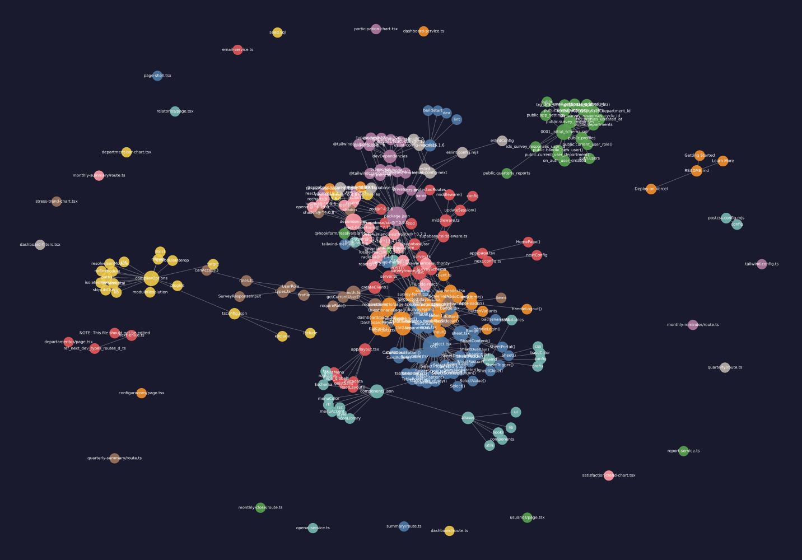

<p align="center">
  <picture>
    <source media="(prefers-color-scheme: dark)" srcset="https://shieldcn.dev/header/graph.svg?title=Vida+Saud%C3%A1vel+Feedback&subtitle=Plataforma+de+Acompanhamento+de+Sa%C3%BAde+e+Nutri%C3%A7%C3%A3o&logo=nextdotjs&theme=emerald&mode=dark" />
    
  </picture>
</p>

<p align="center">
  <a href="https://github.com/MisterAntoY/vida-saudavel-feedback"></a>
  <a href="https://github.com/MisterAntoY/vida-saudavel-feedback"></a>
  <a href="https://nextjs.org/"></a>
  <a href="https://www.typescriptlang.org/"></a>
  <a href="https://www.docker.com/"></a>
</p>

---

Aplicação moderna para acompanhamento nutricional, metas de bem-estar e recolha de feedbacks de pacientes/clientes.

---

## Getting Started

First, run the development server:

```bash
npm run dev
# or
yarn dev
# or
pnpm dev
# or
bun dev
```

Open [http://localhost:3000](http://localhost:3000) with your browser to see the result.

You can start editing the page by modifying `app/page.tsx`. The page auto-updates as you edit the file.

This project uses [`next/font`](https://nextjs.org/docs/app/building-your-application/optimizing/fonts) to automatically optimize and load [Geist](https://vercel.com/font), a new font family for Vercel.

## Learn More

To learn more about Next.js, take a look at the following resources:

- [Next.js Documentation](https://nextjs.org/docs) - learn about Next.js features and API.
- [Learn Next.js](https://nextjs.org/learn) - an interactive Next.js tutorial.

You can check out [the Next.js GitHub repository](https://github.com/vercel/next.js) - your feedback and contributions are welcome!

## Deploy on Vercel

The easiest way to deploy your Next.js app is to use the [Vercel Platform](https://vercel.com/new?utm_medium=default-template&filter=next.js&utm_source=create-next-app&utm_campaign=create-next-app-readme) from the creators of Next.js.

Check out our [Next.js deployment documentation](https://nextjs.org/docs/app/building-your-application/deploying) for more details.

---

## 🗺️ Mapa Arquitetural & Grafo de Dependências

Grafo estrutural e comunidades extraído via [graphify](https://github.com/Graphify-Labs/graphify):

[](./graphify-out/GRAPH_REPORT.md)

- 📊 **Relatório Arquitetural:** [graphify-out/GRAPH_REPORT.md](./graphify-out/GRAPH_REPORT.md)
- 🌐 **Navegador Interativo (HTML):** Abra [`graphify-out/graph.html`](./graphify-out/graph.html) no navegador
- 🔀 **Fluxo de Chamadas & Diagramas:** Abra [`graphify-out/vida-saudavel-feedback-callflow.html`](./graphify-out/vida-saudavel-feedback-callflow.html) para diagramas Mermaid
